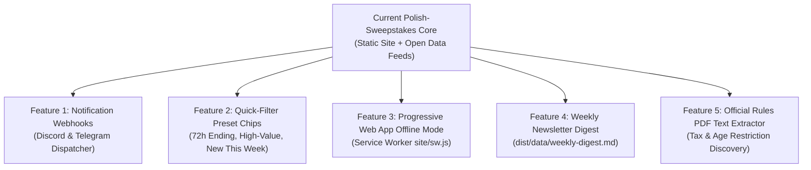

# Polish Sweepstakes — Strategic Roadmap & Future Features

> **Project:** `polish-sweepstakes`  
> **Mission:** Polish sweepstakes, lotteries, and contests with **strictly no purchase required** (including confirmed free alternative methods of entry).  
> **Architecture:** Zero-runtime serverless deployment; GitHub Actions daily automation + static GitHub Pages hosting + open machine-readable datasets.

---

## 1. Architectural Principles & Invariants

Every existing and future feature adheres to these immutable design constraints:
1. **Zero Database / Zero Backend:** The site runs purely as static assets on GitHub Pages. No backend API servers, user authentication databases, or stateful hosting.
2. **Europe/Warsaw Date Boundaries:** All contest active/ended deadlines and sorting are computed against `Europe/Warsaw` time to prevent timezone skew.
3. **Strict No-Purchase Guarantee:** Automated heuristic filters reject contests requiring receipts, purchases, order numbers, promotional packaging, or entry fees, while honoring Alternative Method of Entry (AMoE).
4. **Reproducible Pre-Rendering & Client Fallback:** All listings are pre-rendered into static HTML and schema.org JSON-LD at build time. The site remains fully readable without JavaScript.
5. **Open Data & Agent Readiness:** All data is publicly distributed in JSON (with JSON Schema), flat CSV, RSS 2.0 XML, and compact LLM Markdown formats.

---

## 2. Completed Capabilities Matrix

| Phase | Milestone | Shipped Features | Verification & Artifacts |
| :--- | :--- | :--- | :--- |
| **Core** | Automated Scraper & Quality Pass | • 6 Polish contest sources<br/>• Keyword & taxonomy tagging<br/>• First-party reachability checker (`check.mjs`)<br/>• Dead-link fallback to verified organizer page | • 60 unit tests<br/>• Playwright Chromium smoke gate<br/>• `data/lotteries.json` (v2 contract) |
| **Phase 1** | UX & Syndication Quick Wins | • RSS 2.0 syndication feed (`feed.xml`)<br/>• Direct Google Calendar links & `.ics` downloads<br/>• LocalStorage personal contest tracker (`saved` / `entered`)<br/>• 5-way sorting & two-way URL state sync (`URLSearchParams`)<br/>• Alternative Method of Entry (AMoE) visual callout | • 15 browser smoke tests<br/>• `dist/feed.xml`<br/>• `site/app.js` tracker & URL synchronization |
| **Phase 2** | Data Intelligence & Schemas | • Numeric prize value extraction (`prize.value` in PLN)<br/>• Formal Draft-07 JSON Schema (`data/schema.json`)<br/>• Compact AI agent Markdown digest (`data/active.md`)<br/>• `llms.txt` and full specification `llms-full.txt` | • `scripts/schema.test.mjs`<br/>• `scripts/prize.test.mjs`<br/>• 67 unit tests |
| **Phase 3** | PWA Manifest & Tabular Exports | • Web App Manifest (`manifest.webmanifest`) with standalone display<br/>• Flat RFC 4180 CSV export (`data/lotteries.csv`) | • `dist/manifest.webmanifest`<br/>• `dist/data/lotteries.csv` |
| **Phase 4** | Portable Tracker Backup & Social Badges | • Portable JSON Export & Import of saved/entered contests<br/>• Automatic Social Platform Direct Badges (Instagram, Facebook, TikTok, YouTube) | • `scripts/social.test.mjs`<br/>• 74 unit tests & 17 browser smoke checks |

---

## 3. Future Roadmap: Candidate Features & Technical Specifications

The following features have been researched and queued for future implementation cycles:



### Feature 1: Notification Webhook Dispatcher (`scripts/notify.mjs`)
- **Status:** Queued (Priority P1)
- **Problem Statement:** Power users and community administrators want automated push alerts in Discord servers or Telegram channels whenever fresh no-purchase contests are discovered.
- **Technical Specification:**
  - **Script:** Create `scripts/notify.mjs` executed in GitHub Actions immediately following `npm run scrape`.
  - **Change Detection:** Compares the newly scraped `data/lotteries.json` against the prior checked-in snapshot (git diff or cache) to isolate newly added `id`s.
  - **Discord Webhook Payload:**
    ```json
    {
      "embeds": [{
        "title": "🎁 Nowy konkurs bez zakupu: {title}",
        "url": "{url}",
        "color": 2450411,
        "fields": [
          { "name": "Nagroda", "value": "{prize.summary} (~{prize.value} zł)", "inline": true },
          { "name": "Termin", "value": "{deadline}", "inline": true },
          { "name": "Jak wziąć udział", "value": "{entry.summary}" }
        ],
        "footer": { "text": "Źródło: {source} • polish-sweepstakes" }
      }]
    }
    ```
  - **Telegram Bot API:** Dispatches MarkdownV2 messages via `https://api.telegram.org/bot<TOKEN>/sendMessage`.
  - **Reliability:** Silently skips if `DISCORD_WEBHOOK_URL` or `TELEGRAM_BOT_TOKEN`/`TELEGRAM_CHAT_ID` repository secrets are not configured. Never breaks or fails the CI deployment.

---

### Feature 2: Quick-Filter Preset Chips
- **Status:** Queued (Priority P1)
- **Problem Statement:** Users looking for quick contest opportunities currently must navigate multiple dropdowns and search terms.
- **Technical Specification:**
  - **UI Placement:** A horizontal chip bar rendered between `.controls` and the contest grid:
    - `🔥 Kończące się w 72h (X)` — filters items with `deadline <= today + 3 days`.
    - `💰 Pula > 5 000 zł (Y)` — filters items with `prize.value >= 5000`.
    - `✨ Nowe w tym tygodniu (Z)` — filters items with `publishedAt >= today - 7 days`.
    - `🎁 Bony i vouchery (W)` — filters items with `tags.nagroda` containing `voucher` or `karta-podarunkowa`.
  - **Interaction:** 1-click toggle activating the filter; mutually combinable with existing source and tag selectors.
  - **URL Synchronization:** Serialized into query string as `?preset=72h` or `?preset=high-value`.

---

### Feature 3: Progressive Web App Offline Mode (`site/sw.js`)
- **Status:** Queued (Priority P2)
- **Problem Statement:** Enable offline access so users can review bookmarked contests, rules links, and participation notes without an active network connection (e.g., in transit or on mobile).
- **Technical Specification:**
  - **Service Worker:** Register `site/sw.js` with scope `./`.
  - **Caching Strategies:**
    - **Stale-While-Revalidate:** HTML (`index.html`), CSS (`styles.css`), JS (`app.js`), SVG icons (`favicon.svg`, `og-image.svg`), manifest (`manifest.webmanifest`).
    - **Network-First with Cache Fallback:** `data/lotteries.json`. When online, fetches the fresh daily dataset; when offline, transparently serves the cached snapshot.
  - **Cache Versioning:** Cache name keyed to dataset generation or application version (`polish-sweepstakes-cache-v1`) with automatic pruning of outdated cache entries on activate.

---

### Feature 4: Weekly Newsletter & Community Markdown Digest (`dist/data/weekly-digest.md`)
- **Status:** Queued (Priority P3)
- **Problem Statement:** Community managers and bloggers want a ready-to-publish Markdown digest of the week's best contests for sharing on Wykop, Reddit (r/Polska), Discord, or Substack newsletters.
- **Technical Specification:**
  - **Output:** Generated during `npm run build` into `dist/data/weekly-digest.md`.
  - **Contents:**
    - Top 5 expiring contests (urgency).
    - Top 5 highest monetary prizes (value).
    - 3 featured creative contests (photography/writing).
    - Direct rules and organizer links formatted cleanly with Markdown anchors.

---

### Feature 5: Automated Official Rules PDF Heuristic Scanner
- **Status:** Queued (Priority P3)
- **Problem Statement:** In Polish contest law, prizes above 2,000 PLN are subject to 10% personal income tax unless covered by the organizer or exempt. Contestants frequently need to check whether the organizer provides an additional cash prize covering this tax.
- **Technical Specification:**
  - **Parser:** Headless PDF text parsing (`pdf-parse`) of verified reachable `links.regulamin` PDFs during extraction.
  - **Tax Detection:** Scans for standard tax reimbursement clauses (*"dodatkowa nagroda pieniężna w wysokości 11,11% wartości nagrody rzeczowej przeznaczona na pokrycie należnego podatku"*).
  - **Enrichment:** Adds `prize.taxCovered: true|false|null` to the schema and card badge: `🛡️ Podatek opłacony przez organizatora`.

---

## 4. Maintenance & Operational Cadence

- **Daily Scraper Pipeline:** Runs at 05:17 UTC (06:17 Warsaw winter / 07:17 summer) via `.github/workflows/deploy.yml`.
- **Pre-Deployment Gate:** Every pull request and push to `main` must pass:
  1. `npm test`: Node unit, pipeline, and schema validation tests.
  2. `npm run build`: Production static build.
  3. `npm run test:browser`: Headless Playwright Chromium smoke checks (fixtures + production built site).
- **Weekly Snapshot Maintenance:** Workflows commit real data snapshots to `main` every 7 days to preserve repository activity and prevent GitHub Actions schedule deactivation.
